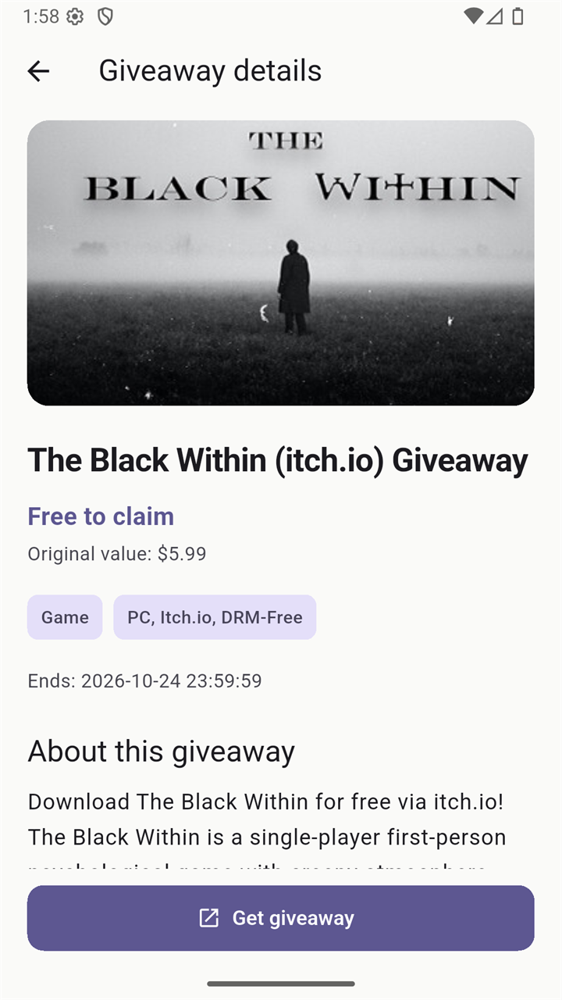
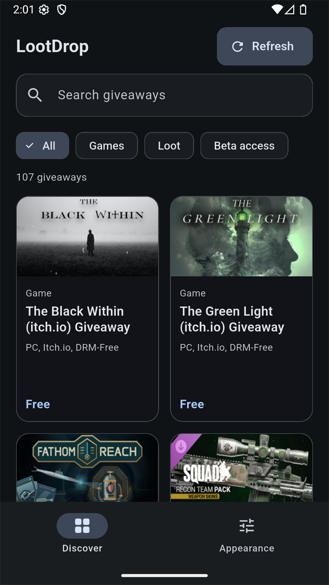

# LootDrop

**Find your next free game, bonus item or beta invitation.**

LootDrop is a Flutter giveaway browser powered by GamerPower. Search the catalogue, narrow it by category, read claim instructions and open an offer in your external browser. A Material 3 interface pairs light, dark and system modes with twelve saved accent choices.

Built as a MAD-III course assignment, with Riverpod state management and a focus on clear loading, refresh and recovery states.

## A look inside

| Discover | Giveaway details |
| --- | --- |
|  |  |
| Appearance | Dark mode |
|  |  |

Existing screenshots are retained from the repository. Their binary contents were not available for inspection in this text export.

## Browse without losing your place

- **Search and filter together:** match title, platform or type, then select All, Games, Loot or Beta access.
- **See the offer clearly:** artwork, original value, platform/type tags, end date, description and instructions appear when supplied.
- **Refresh without a blank screen:** existing results stay visible while a request runs. Duplicate refreshes are suppressed; failures retain the previous list and offer retry.
- **Recover from missing content:** initial-error, empty-catalogue, no-match and artwork-failure states have dedicated messages.
- **Choose your appearance:** display mode and accent are stored locally, with rollback and inline feedback if saving fails.
- **Adapt the catalogue:** grid columns respond to available width and text scaling. Discover and Appearance remain mounted through an IndexedStack.

Claiming happens outside LootDrop. The app does not redeem offers, manage store accounts or verify that a giveaway is still claimable. There are no bookmarks, notifications or persistent offline catalogue in the supplied application.

## Run locally

The manifest declares Dart `^3.13.5`; the lockfile records Dart `>=3.13.5 <4.0.0` and Flutter `>=3.44.0`. Use a Flutter installation compatible with those constraints and your target platform's toolchain.

From the original repository root:

```sh
flutter pub get
flutter run
```

No API key, environment file or separate backend is configured in the supplied code. The feed URL is fixed in the provider. Retain the lockfile and the existing Android preferences override when reproducing the current dependency set; this refresh does not validate or remove that override.

## Stack and source map

| Area | Implementation |
| --- | --- |
| Interface | Flutter, Dart and Material 3 |
| State | Riverpod Notifier/AsyncNotifier providers |
| Requests | HTTP client with a 20-second request timeout |
| Preferences | SharedPreferences |
| External pages | url_launcher |
| Tests | flutter_test, mocked HTTP and mocked preferences |

```text
lib/
  main.dart                 ProviderScope entry point
  app.dart                  Themes and settings startup states
  models/giveaway.dart      Parsing and metadata guards
  providers/                Feed, browsing, navigation and appearance state
  screens/                  Discover, details and appearance
  theme/                    Seed-colour themes and accent definitions
  widgets/                  Cards, grid, artwork, link handling and toast
test/
  core_test.dart            Parser, filtering, HTTP, refresh and preferences
  layout_test.dart          Browse/detail/settings widget scenarios
```

The Dart package remains `game_giveaways`. Keeping the public name LootDrop does not require changing imports or platform identifiers.

## Data and links

Listings come from [GamerPower](https://www.gamerpower.com/). Search/filtering runs locally over the fetched list. Successful refresh replaces that list; failed refresh preserves it only in memory. A fresh launch still needs network access.

Artwork and claim links must have an HTTPS scheme and a non-empty host to pass the supplied helpers. That is format validation, not domain verification or a guarantee that an offer is official or safe. Check the destination and publisher conditions before signing in or claiming anything. Missing or unavailable metadata is omitted rather than presented as an empty label.

## Checks

```sh
dart format --output=none --set-exit-if-changed lib test
flutter analyze
flutter test
flutter build apk --release
```

The source contains seven core tests and a widget-test matrix covering three widths, two text scales and both brightness modes. These are test definitions, not fresh passing results. They do not establish live API availability, real-device behaviour, screen-reader compatibility or every external-link outcome.

The earlier README reports a Flutter 3.47.6 / Dart 3.13.5 run with 19 passing tests and an Android emulator release check. That is retained as a **previous repository-reported result**, not independently reproduced in this refresh. See [verification notes](docs/repository-refresh.md).

## Android demo and release boundaries

The previous README links to the [repository's release page](https://github.com/SRUN-Sochettra/LootDrop/releases/latest). The current release asset, download size and checksum were not retrieved or verified here.

Android configuration currently uses debug signing for release builds and the example application ID `com.example.game_giveaways`. It is suitable to review as a demo configuration, not to advertise as store-ready signing. Platform folders for iOS, web and desktop are included, but this refresh did not build them. macOS entitlements do not declare network-client access in the supplied files.

## Contributing, security and licence

Read [CONTRIBUTING.md](CONTRIBUTING.md) and [SECURITY.md](SECURITY.md). Source review and packaging checks were performed; Flutter analysis, tests, builds and live requests were not run during this refresh.

No project licence file is included in the supplied export. This refresh does not assign a licence or establish rights to third-party artwork and listing content. `publish_to: none` is a package-publishing setting, not a source-code licence.
